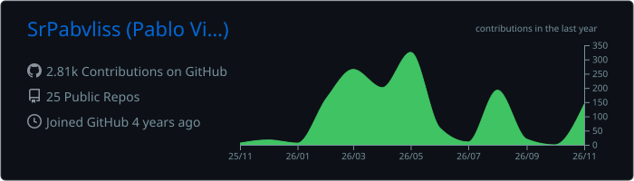
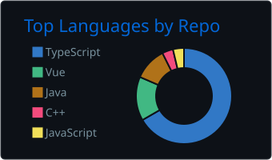
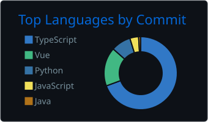
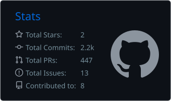
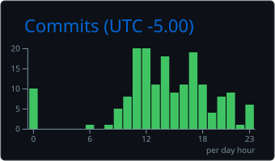

<h1 align="center">Hi, I'm Pablo Villacres 👋</h1>
<h3 align="center">Full Stack Engineer · Node.js · React · TypeScript · Agentic workflows</h3>

  
  
  

## About me

I'm a Full Stack Engineer from Ecuador with **3+ years** shipping web and mobile apps for U.S. and enterprise clients. Today I build almost everything with AI agents, and I think the real job is no longer typing code: it's deciding what should be built, keeping the codebase predictable, and proving that what ships actually works.

- 🤖 **Agentic workflow:** Claude Code with custom skills, plugins and subagents; spec-driven development, TDD, and a review of every diff before it merges.
- 🏗️ **Architecture:** Clean Architecture and CQRS, structured so both people and agents never get lost.
- 🧪 **Quality:** test flows, not functions; check the data, not just the screen.
- 🌎 Currently a Full Stack Developer at **SENIROP**, working remotely with U.S. clients.
- 🎹 Off the keyboard, I play piano and make music.

Most of my professional work lives in private repositories; happy to walk through any of it in an interview.

## Tech stack

**Frontend**

**Backend**

**Mobile**

 

**Databases, cloud and tools**

## GitHub stats

  

  
  

  
  

---

  

